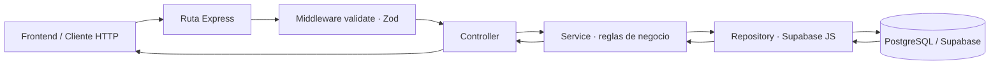

# Backend de LabCare

Documentación técnica del servidor Express/Node de LabCare. Explica cómo está organizado, cómo fluye una petición y qué fragmentos de código sostienen las reglas del sistema. El código completo está en `backend/` y el esquema PostgreSQL en `database/schema.sql`.

---

## 1. Responsabilidades

El backend es el **único** componente que se comunica con Supabase. El navegador nunca recibe la clave administrativa: solo consume la API REST en `/api`.

| Capa | Archivos | Función |
|---|---|---|
| Entrada | `server.js`, `app.js` | Arranca HTTP, seguridad base, CORS, health check |
| Rutas | `backend/routes/` | Define URLs y aplica validaciones Zod |
| Controladores | `backend/controllers/` | Traduce HTTP ↔ casos de uso |
| Servicios | `backend/services/` | Reglas de negocio y transiciones de estado |
| Modelo | `backend/models/solicitud.model.js` | Constantes y transiciones permitidas |
| Repositorios | `backend/repositories/` | Consultas a Supabase/PostgreSQL |
| Validación | `backend/validators/`, `backend/middlewares/validate.js` | Esquemas Zod y rechazo de datos inválidos |
| Errores | `backend/utils/ApiError.js`, `middlewares/errorHandler.js` | Respuestas JSON consistentes |
| Base de datos | `database/schema.sql` | Tablas, FKs, checks, triggers, RPC y vista |

---

## 2. Arranque y configuración

`backend/server.js` es deliberadamente pequeño:

```js
const app = require('./app');
const env = require('./config/env');

app.listen(env.PORT, () => {
  console.log(`[LabCare] API escuchando en http://localhost:${env.PORT}/api`);
  console.log(`[LabCare] Orígenes CORS permitidos: ${env.CORS_ORIGIN}`);
});
```

La configuración se valida al iniciar con Zod. Si falta algo, el proceso termina con un mensaje claro en lugar de fallar más adelante:

```js
// backend/config/env.js
const envSchema = z
  .object({
    SUPABASE_URL: z.string().url('SUPABASE_URL debe ser una URL válida'),
    SUPABASE_SECRET_KEY: z.string().min(20).optional(),
    SUPABASE_SERVICE_ROLE_KEY: z.string().min(20).optional(),
    PORT: z.coerce.number().int().positive().default(3000),
    CORS_ORIGIN: z.string().default('http://localhost:5173'),
    NODE_ENV: z.enum(['development', 'test', 'production']).default('development'),
  })
  .refine(
    (datos) =>
      Boolean(datos.SUPABASE_SECRET_KEY || datos.SUPABASE_SERVICE_ROLE_KEY),
    {
      message: 'Define SUPABASE_SECRET_KEY o SUPABASE_SERVICE_ROLE_KEY en backend/.env',
      path: ['SUPABASE_SECRET_KEY'],
    },
  );

// Normalizamos ambos formatos a una sola clave para el cliente de Supabase.
const apiKey =
  parsed.data.SUPABASE_SECRET_KEY || parsed.data.SUPABASE_SERVICE_ROLE_KEY;

module.exports = Object.freeze({
  ...parsed.data,
  SUPABASE_API_KEY: apiKey,
});
```

Puntos importantes:

- `dotenv.config({ path: .../backend/.env })` carga **solo** el archivo del backend.
- Se acepta la clave nueva `sb_secret_...` o la legada `service_role` (`eyJ...`).
- La clave se expone al cliente oficial `@supabase/supabase-js` desde `backend/config/supabase.js`.
- `backend/.env` está ignorado por Git; jamás se sube al repositorio.

---

## 3. Aplicación Express

`backend/app.js` concentra la configuración HTTP y el health check real contra Supabase:

```js
const app = express();

const origenesPermitidos = env.CORS_ORIGIN.split(',')
  .map((origen) => origen.trim())
  .filter(Boolean);

app.disable('x-powered-by');
app.use(helmet());
app.use(
  cors({
    origin: origenesPermitidos,
    methods: ['GET', 'POST', 'PUT', 'PATCH', 'DELETE', 'OPTIONS'],
    allowedHeaders: ['Content-Type', 'Authorization'],
  }),
);
app.use(express.json({ limit: '1mb' }));

app.get('/api/health', async (req, res) => {
  const { error } = await supabase.from('equipos').select('id').limit(1);
  res.status(error ? 503 : 200).json({
    success: !error,
    servicio: 'LabCare API',
    supabase: error ? 'sin conexión' : 'conectado',
    entorno: env.NODE_ENV,
  });
});

app.use('/api/solicitudes', require('./routes/solicitudesRoutes'));
app.use('/api/equipos', require('./routes/equiposRoutes'));
app.use('/api/dashboard', require('./routes/dashboardRoutes'));

app.use(notFound);
app.use(errorHandler);
```

El health check **consulta de verdad** la tabla `equipos`; no es un valor simulado.

---

## 4. Flujo de una petición



### 4.1 Rutas

Las rutas estáticas van antes que `/:id` para que `/historial` no sea capturado como un UUID:

```js
// backend/routes/solicitudesRoutes.js
const router = express.Router();

// Rutas estáticas primero para que '/historial' no sea capturado por '/:id'.
router.get('/', validate(listarSolicitudesSchema, 'query'), controller.listar);
router.get(
  '/historial',
  validate(listarSolicitudesSchema, 'query'),
  controller.listarHistorialGeneral,
);
router.post('/', validate(crearSolicitudSchema, 'body'), controller.crear);

router.get('/:id/historial', validate(idSchema, 'params'), controller.historial);
router.patch(
  '/:id/estado',
  validate(idSchema, 'params'),
  validate(cambiarEstadoSchema, 'body'),
  controller.cambiarEstado,
);
router.get('/:id', validate(idSchema, 'params'), controller.obtener);
router.put(
  '/:id',
  validate(idSchema, 'params'),
  validate(actualizarSolicitudSchema, 'body'),
  controller.actualizar,
);
router.delete('/:id', validate(idSchema, 'params'), controller.eliminar);
```

### 4.2 Validación con Zod

Los mismos valores permitidos del modelo se reutilizan en los esquemas:

```js
// backend/validators/solicitud.validator.js
const texto = (min, max, nombre) =>
  z
    .string({ required_error: `${nombre} es obligatorio` })
    .trim()
    .min(min, `${nombre} debe tener al menos ${min} caracteres`)
    .max(max, `${nombre} no puede superar ${max} caracteres`);

const crearSolicitudSchema = z.object({
  equipo_id: uuid,
  solicitante: texto(3, 120, 'El solicitante'),
  descripcion: texto(10, 2000, 'La descripción'),
  prioridad: z.enum(PRIORIDADES, {
    message: 'Prioridad inválida. Use BAJA, MEDIA o ALTA',
  }),
});
```

Esto cubre los casos negativos CP-02, CP-03 y CP-04: solicitante vacío, descripción corta y prioridad inválida devuelven `400` antes de tocar la base de datos.

### 4.3 Controlador

Los controladores no contienen lógica de negocio; solo delegan y responden:

```js
// backend/controllers/solicitudesController.js
const crear = asyncHandler(async (req, res) => {
  const solicitud = await service.crear(req.validado.body);
  creado(res, solicitud, 'Solicitud registrada correctamente');
});

const cambiarEstado = asyncHandler(async (req, res) => {
  const solicitud = await service.cambiarEstado(
    req.validado.params.id,
    req.validado.body.estado,
  );
  exito(res, solicitud, 'Estado actualizado correctamente');
});

const eliminar = asyncHandler(async (req, res) => {
  const resultado = await service.eliminarLogicamente(req.validado.params.id);
  exito(res, resultado, 'Solicitud eliminada lógicamente');
});
```

`req.validado` es producido por el middleware `validate`; el controlador nunca confía en `req.body` directamente.

### 4.4 Servicio: reglas de negocio

El servicio valida la existencia del equipo, pide el código a PostgreSQL y fija el estado inicial:

```js
// backend/services/solicitudesService.js
const crear = async (datos) => {
  await validarEquipo(datos.equipo_id);

  // La función SQL usa un candado de fila por fecha: seguro ante concurrencia.
  const codigoSolicitud = await repository.generarCodigo();

  return repository.crear({
    codigo_solicitud: codigoSolicitud,
    equipo_id: datos.equipo_id,
    solicitante: datos.solicitante,
    descripcion: datos.descripcion,
    prioridad: datos.prioridad,
    estado: 'PENDIENTE',
    activo: true,
  });
};
```

La transición de estado se decide aquí, no en el frontend:

```js
const cambiarEstado = async (id, estadoNuevo) => {
  const solicitud = await obtenerPorId(id);

  if (!esTransicionPermitida(solicitud.estado, estadoNuevo)) {
    const permitidos = TRANSICIONES_PERMITIDAS[solicitud.estado] || [];
    const detalle = permitidos.length
      ? `Desde ${solicitud.estado} solo se permite: ${permitidos.join(', ')}`
      : `La solicitud ya está en un estado final (${solicitud.estado})`;
    throw new ApiError(409, 'Transición de estado no permitida', detalle);
  }

  const actualizada = await repository.cambiarEstado(id, estadoNuevo);
  if (!actualizada) {
    throw new ApiError(404, 'No se encontró la solicitud solicitada');
  }
  return actualizada;
};
```

Y la eliminación nunca ejecuta `DELETE` físico:

```js
const eliminarLogicamente = async (id) => {
  const eliminada = await repository.desactivar(id);
  if (!eliminada) {
    throw new ApiError(404, 'No se encontró la solicitud activa solicitada');
  }
  return {
    id: eliminada.id,
    codigo_solicitud: eliminada.codigo_solicitud,
    activo: false,
  };
};
```

### 4.5 Modelo de dominio

```js
// backend/models/solicitud.model.js
const TRANSICIONES_PERMITIDAS = Object.freeze({
  PENDIENTE: ['EN_PROCESO', 'CANCELADA'],
  EN_PROCESO: ['RESUELTA', 'CANCELADA'],
  RESUELTA: [],
  CANCELADA: [],
});

const esTransicionPermitida = (estadoActual, estadoNuevo) =>
  (TRANSICIONES_PERMITIDAS[estadoActual] || []).includes(estadoNuevo);
```

`RESUELTA` y `CANCELADA` son finales. Por eso `RESUELTA → PENDIENTE` responde `409` (CP-08).

---

## 5. Repositorio y base de datos

El repositorio construye consultas encadenadas y traduce errores de PostgreSQL:

```js
// backend/repositories/solicitudesRepository.js
const VISTA = 'v_solicitudes_detalle';
const CON_EQUIPO = '*, equipos(id, codigo, nombre, ubicacion, estado)';

const listar = async ({
  q,
  prioridad,
  estado,
  incluirInactivas = false,
  limite,
} = {}) => {
  let consulta = supabase.from(VISTA).select('*');

  if (!incluirInactivas) consulta = consulta.eq('activo', true);
  if (prioridad) consulta = consulta.eq('prioridad', prioridad);
  if (estado) consulta = consulta.eq('estado', estado);
  if (q) {
    consulta = consulta.or(
      filtroIlike(q, [
        'codigo_solicitud',
        'solicitante',
        'equipo_nombre',
        'equipo_codigo',
      ]),
    );
  }

  consulta = consulta.order('fecha_registro', { ascending: false });
  if (limite) consulta = consulta.limit(limite);

  const { data, error } = await consulta;
  verificarError(error, 'la consulta de solicitudes');
  return data || [];
};
```

El código de solicitud se genera dentro de PostgreSQL con bloqueo de fila:

```sql
-- database/schema.sql
CREATE OR REPLACE FUNCTION public.generar_codigo_solicitud()
RETURNS TEXT
LANGUAGE plpgsql
AS $$
DECLARE
    v_fecha DATE := CURRENT_DATE;
    v_numero INTEGER;
BEGIN
    INSERT INTO public.contadores_codigo (fecha, ultimo)
    VALUES (v_fecha, 0)
    ON CONFLICT (fecha) DO NOTHING;

    SELECT ultimo + 1 INTO v_numero
    FROM public.contadores_codigo
    WHERE fecha = v_fecha
    FOR UPDATE;

    UPDATE public.contadores_codigo
    SET ultimo = v_numero
    WHERE fecha = v_fecha;

    RETURN 'SOL-' || to_char(v_fecha, 'YYYYMMDD') || '-' || lpad(v_numero::TEXT, 3, '0');
END;
$$;
```

El historial es automático, no depende de que el frontend lo envíe:

```sql
CREATE OR REPLACE FUNCTION public.registrar_historial_estado()
RETURNS TRIGGER
LANGUAGE plpgsql
AS $$
BEGIN
    IF NEW.estado IS DISTINCT FROM OLD.estado THEN
        INSERT INTO public.historial_estados (solicitud_id, estado_anterior, estado_nuevo)
        VALUES (NEW.id, OLD.estado, NEW.estado);
    END IF;
    RETURN NEW;
END;
$$;

CREATE TRIGGER trg_solicitudes_historial_estado
    AFTER UPDATE OF estado ON public.solicitudes
    FOR EACH ROW
    EXECUTE FUNCTION public.registrar_historial_estado();
```

La eliminación lógica en repositorio es un `UPDATE`, nunca un `DELETE`:

```js
const desactivar = async (id) => {
  const { data, error } = await supabase
    .from('solicitudes')
    .update({ activo: false })
    .eq('id', id)
    .eq('activo', true)
    .select(CON_EQUIPO)
    .maybeSingle();

  verificarError(error, 'la eliminación lógica');
  return data;
};
```

---

## 6. Manejo de errores

Los errores de Supabase se convierten a códigos HTTP controlados:

```js
// backend/utils/supabase.js
if (codigo === '23505') {
  throw new ApiError(409, 'El código o registro ya existe', 'Conflicto de duplicidad');
}
if (codigo === '23503') {
  throw new ApiError(404, 'El equipo seleccionado no existe', 'Referencia inválida');
}
if (codigo === '23514' || codigo === '22P02') {
  throw new ApiError(400, 'Los datos enviados no cumplen las restricciones de la base de datos');
}
```

Y el middleware final nunca devuelve trazas internas:

```js
// backend/middlewares/errorHandler.js
if (status >= 500) {
  console.error('[LabCare] Error no controlado:', error.message);
  details = null;
}

res.status(status).json({
  success: false,
  error: mensaje,
  ...(details && status < 500 ? { details } : {}),
});
```

Las búsquedas `ilike` también escapan caracteres especiales para no alterar la sintaxis de PostgREST:

```js
// backend/utils/query.js
const escaparIlike = (valor) => String(valor).replace(/[\\%_]/g, '\\$&');
const valorEntreComillas = (valor) => `"${String(valor).replace(/[\\"]/g, '\\$&')}"`;
```

---

## 7. API REST resumida

| Método | Ruta | Descripción |
|---|---|---|
| `GET` | `/api/health` | Estado de la API y conexión real con Supabase |
| `GET` | `/api/solicitudes` | Activas; acepta `q`, `prioridad`, `estado` |
| `GET` | `/api/solicitudes/historial` | Todas, incluidas inactivas |
| `POST` | `/api/solicitudes` | Registrar → `201` |
| `GET` | `/api/solicitudes/:id` | Detalle → `200` / `404` |
| `PUT` | `/api/solicitudes/:id` | Editar datos descriptivos |
| `PATCH` | `/api/solicitudes/:id/estado` | Cambiar estado → `200` / `409` |
| `DELETE` | `/api/solicitudes/:id` | Eliminación lógica |
| `GET` | `/api/solicitudes/:id/historial` | Transiciones de una solicitud |
| `GET` | `/api/equipos` | Catálogo de equipos |
| `GET` | `/api/dashboard/estadisticas` | Indicadores reales |

Respuestas consistentes:

```json
{ "success": true, "message": "…", "data": { } }
{ "success": false, "error": "…", "details": { } }
```

---

## 8. Seguridad

- Helmet, `x-powered-by` desactivado y cuerpo JSON limitado a 1 MB.
- CORS restringido a los orígenes de `CORS_ORIGIN`.
- Clave de Supabase **solo en backend**; el frontend solo conoce `VITE_API_URL`.
- RLS habilitado en todas las tablas del esquema.
- Validación Zod antes de cualquier escritura.
- Errores 500 sin `details` hacia el cliente.
- `FOR UPDATE` evita códigos duplicados por concurrencia.

---

## 9. Verificación

```bash
npm test                 # 12 pruebas unitarias de dominio
npm run verificar:api    # CP-01..CP-12 contra la API y Supabase
npm run auditoria        # informe + evidencias en docs/evidencias/
```

El detalle de la ejecución real está en [`docs/INFORME_PRUEBAS.md`](docs/INFORME_PRUEBAS.md) y la memoria general en [`DESARROLLO_COMPLETO_LABCARE.md`](DESARROLLO_COMPLETO_LABCARE.md).
