# DESARROLLO COMPLETO DEL SISTEMA LABCARE

## Sistema web de gestión de solicitudes de mantenimiento de equipos de laboratorio

Actúa como un ingeniero de software senior, arquitecto de soluciones y desarrollador Full Stack. Necesito que desarrolles un sistema web completo, funcional, moderno y profesional denominado **LabCare**, siguiendo buenas prácticas de desarrollo, arquitectura MVC, separación de responsabilidades y persistencia real de datos.

El sistema será desarrollado como parte del examen práctico integrador de la asignatura Desarrollo de Sistemas II de la Universidad Privada Domingo Savio (UPDS).

**IMPORTANTE:** No quiero únicamente un prototipo visual ni pantallas estáticas. Necesito una aplicación funcional, con frontend conectado al backend y backend conectado a una base de datos real en Supabase.

---

# 1. OBJETIVO DEL SISTEMA

LabCare es un sistema web para administrar laboratorios de computación y gestionar solicitudes de mantenimiento de sus equipos tecnológicos.

Actualmente, las fallas se reportan mediante mensajes y hojas de cálculo, provocando pérdida de solicitudes y falta de seguimiento sobre el estado de las reparaciones.

El sistema debe permitir registrar, consultar, editar, buscar, filtrar, actualizar estados y eliminar lógicamente solicitudes de mantenimiento.

El catálogo de equipos debe consultarse desde la base de datos.

# 2. TECNOLOGÍAS OBLIGATORIAS

Utiliza las siguientes tecnologías:

## Frontend
- React.
- Vite.
- JavaScript o TypeScript, según la estructura existente.
- Bootstrap 5 para los estilos.
- React Router para navegación.
- Axios o Fetch API para consumir el backend.
- SweetAlert2 para confirmaciones y notificaciones, si resulta conveniente.
- Lucide React para iconografía.

## Backend
- Node.js.
- Express.js.
- Arquitectura MVC.
- Controladores para gestionar las solicitudes HTTP.
- Modelos o repositorios para acceder a los datos.
- Servicios para implementar las reglas de negocio.
- Rutas REST para las operaciones CRUD.
- Validaciones con Zod o una alternativa equivalente.

## Base de datos
- Supabase.
- PostgreSQL como motor de base de datos.
- Supabase SQL Editor para ejecutar el script de creación de tablas.
- Variables de entorno para configurar la conexión.
- Restricciones, claves primarias, claves foráneas e índices.

**IMPORTANTE:** Supabase debe ser la base de datos real del sistema. No utilizar arrays, objetos en memoria, localStorage ni archivos JSON como sustitutos de persistencia.

# 3. ARQUITECTURA DEL PROYECTO

Organiza el proyecto siguiendo una arquitectura MVC o MVC/API.

Separa claramente:

Frontend:
- components/
- pages/
- layouts/
- services/
- hooks/
- routes/
- assets/
- styles/

Backend:
- config/
- models/
- controllers/
- services/
- repositories/
- routes/
- middlewares/
- validators/
- utils/

El frontend debe comunicarse exclusivamente con la API del backend para las operaciones del sistema.

El backend será responsable de validar los datos, ejecutar las reglas de negocio y comunicarse con Supabase.

No coloques toda la lógica en un único archivo.

# 4. BASE DE DATOS EN SUPABASE

Diseña e implementa una base de datos PostgreSQL con las siguientes tablas.

## Tabla: equipos

Campos:
- id: UUID, clave primaria.
- codigo: VARCHAR, obligatorio y único.
- nombre: VARCHAR, obligatorio.
- ubicacion: VARCHAR, obligatorio.
- estado: VARCHAR, obligatorio.
- created_at: TIMESTAMP.

## Tabla: solicitudes

Campos:
- id: UUID, clave primaria.
- codigo_solicitud: VARCHAR, obligatorio y único.
- equipo_id: UUID, clave foránea que referencia a equipos.id.
- solicitante: VARCHAR, obligatorio.
- descripcion: TEXT, obligatorio.
- prioridad: VARCHAR, obligatorio.
- estado: VARCHAR, obligatorio.
- fecha_registro: TIMESTAMP.
- fecha_actualizacion: TIMESTAMP.
- activo: BOOLEAN, por defecto TRUE.

## Relaciones

Un equipo puede tener muchas solicitudes de mantenimiento.

Una solicitud pertenece a un único equipo.

Implementa correctamente la relación mediante una clave foránea.

## Restricciones

- Los códigos de equipos deben ser únicos.
- Los códigos de solicitudes deben ser únicos.
- No permitir solicitudes sin equipo.
- No permitir solicitantes vacíos.
- No permitir descripciones vacías.
- Prioridad únicamente BAJA, MEDIA o ALTA.
- Estado únicamente PENDIENTE, EN_PROCESO, RESUELTA o CANCELADA.
- activo debe tener valor TRUE por defecto.

## Datos iniciales obligatorios

Inserta estos cuatro equipos en Supabase:

| Código | Nombre | Ubicación | Estado |
| EQ-001 | Computadora de escritorio | Laboratorio 1 | OPERATIVO |
| EQ-002 | Proyector multimedia | Aula 204 | OPERATIVO |
| EQ-003 | Router de laboratorio | Laboratorio de Redes | OPERATIVO |
| EQ-004 | Impresora de oficina | Secretaría | OPERATIVO |

Genera un archivo:

database/schema.sql

Este archivo debe contener:
1. Creación de tablas.
2. Relaciones.
3. Restricciones.
4. Índices necesarios.
5. Triggers para actualizar fecha_actualizacion cuando corresponda.
6. Datos iniciales de equipos.
7. Funciones o mecanismos necesarios para generar códigos únicos.

El script debe poder ejecutarse desde Supabase SQL Editor.

# 5. FUNCIONALIDADES DEL SISTEMA

## Módulo 1: Dashboard principal

Desarrolla un panel principal con:

- Total de solicitudes registradas.
- Solicitudes pendientes.
- Solicitudes en proceso.
- Solicitudes resueltas.
- Solicitudes canceladas.
- Cantidad de equipos registrados.
- Solicitudes recientes.
- Distribución de solicitudes por prioridad.
- Distribución de solicitudes por estado.

Los indicadores deben obtenerse desde Supabase mediante el backend y actualizarse cuando cambien los registros.

Incluye tarjetas estadísticas, iconos y gráficos sencillos si aportan valor.

## Módulo 2: Gestión de equipos

Permite:

- Listar todos los equipos.
- Consultar sus detalles.
- Visualizar código, nombre, ubicación y estado.
- Buscar equipos por código o nombre.
- Consultar los equipos disponibles para registrar solicitudes.

Para el alcance del examen, utiliza los cuatro equipos iniciales y permite consultar el catálogo desde la base de datos.

No inventes equipos adicionales.

## Módulo 3: Gestión de solicitudes

Esta es la funcionalidad principal del sistema.

### Registrar solicitud

Crear un formulario que permita:

- Seleccionar un equipo existente mediante un selector desplegable.
- Ingresar nombre del solicitante.
- Escribir descripción de la falla.
- Seleccionar prioridad: BAJA, MEDIA o ALTA.

El sistema debe generar automáticamente:

- Código de solicitud único.
- Fecha de registro.
- Fecha de actualización.
- Estado inicial PENDIENTE.
- Activo TRUE.

Formato recomendado del código:

SOL-AAAAMMDD-XXX

Ejemplo: SOL-20261123-001.

El código debe generarse de manera segura y sin duplicados, incluso si dos usuarios registran solicitudes simultáneamente.

### Listar solicitudes

Mostrar una tabla con:

- Código de solicitud.
- Equipo.
- Solicitante.
- Descripción resumida.
- Prioridad.
- Estado.
- Fecha de registro.
- Acciones.

Las acciones disponibles serán:

- Ver detalle.
- Editar.
- Cambiar estado.
- Eliminar lógicamente.

El listado habitual debe mostrar únicamente solicitudes con activo = TRUE.

### Consultar detalle

Al seleccionar una solicitud, mostrar:

- Código de solicitud.
- Información completa del equipo.
- Solicitante.
- Descripción completa.
- Prioridad.
- Estado actual.
- Fecha de registro.
- Fecha de actualización.

### Editar solicitud

Permitir editar:
- Equipo.
- Solicitante.
- Descripción.
- Prioridad.

No permitir modificar:
- ID.
- Código de solicitud.
- Fecha original de registro.
- Estado mediante el formulario de edición.

La modificación del estado debe tener una operación independiente.

### Cambiar estado

Implementar un botón o selector para actualizar el estado de una solicitud.

Las transiciones permitidas son:

PENDIENTE:
- EN_PROCESO.
- CANCELADA.

EN_PROCESO:
- RESUELTA.
- CANCELADA.

RESUELTA:
- No permite nuevas transiciones.

CANCELADA:
- No permite nuevas transiciones.

No permitir regresar una solicitud finalizada a un estado anterior.

El backend debe verificar estas reglas antes de actualizar la base de datos.

Si la transición no está permitida, devolver un mensaje claro y no modificar el registro.

### Eliminación lógica

Implementar eliminación lógica.

Al eliminar una solicitud:
- Mostrar una confirmación.
- Cambiar activo a FALSE.
- No borrar físicamente el registro.
- Excluirla del listado habitual.
- Mantenerla almacenada en Supabase.

## Módulo 4: Búsqueda y filtros

Implementar:

- Búsqueda por código de solicitud.
- Búsqueda por nombre del solicitante.
- Búsqueda por nombre del equipo.
- Filtro por prioridad.
- Filtro por estado.
- Botón para limpiar filtros.

La búsqueda debe ignorar diferencias entre mayúsculas y minúsculas cuando corresponda.

Los filtros deben combinarse correctamente.

## Módulo 5: Historial y seguimiento

Crear una vista para consultar solicitudes registradas y sus estados actuales.

Si implementas un historial de transiciones, crea una tabla adicional historial_estados que registre:

- ID.
- Solicitud.
- Estado anterior.
- Estado nuevo.
- Fecha del cambio.

Esta funcionalidad adicional no debe sustituir los campos obligatorios de la tabla solicitudes.

# 6. DISEÑO E INTERFAZ

Quiero una interfaz moderna, profesional, limpia y responsive.

El diseño debe transmitir una herramienta institucional para la administración de laboratorios universitarios.

## Identidad visual

Utiliza:
- Azul oscuro como color principal.
- Azul institucional como color secundario.
- Blanco como fondo principal.
- Gris claro para superficies y tablas.
- Verde para estados resueltos.
- Amarillo o naranja para pendientes.
- Azul para solicitudes en proceso.
- Rojo para canceladas y alertas.

## Estructura general

Implementa:

1. Sidebar lateral con navegación.
2. Barra superior con nombre del sistema.
3. Área principal de contenido.
4. Dashboard con tarjetas estadísticas.
5. Tablas modernas y legibles.
6. Formularios con etiquetas claras.
7. Modales para registrar y editar solicitudes.
8. Ventanas de confirmación para eliminar.
9. Alertas de éxito y error.
10. Estados visuales mediante badges.

## Navegación lateral

Incluye las siguientes opciones:

- Dashboard.
- Solicitudes.
- Equipos.
- Historial.
- Documentación (opcional).

Cada opción debe navegar correctamente a su pantalla.

## Diseño responsive

El sistema debe adaptarse a:
- Computadoras de escritorio.
- Laptops.
- Tablets.
- Teléfonos móviles.

Evita tablas que desborden la pantalla y formularios difíciles de utilizar.

No sobrecargues la interfaz con animaciones innecesarias.

# 7. BACKEND Y API REST

Implementa los siguientes endpoints:

### Solicitudes

GET /api/solicitudes
- Listar solicitudes activas.
- Aceptar parámetros de búsqueda y filtros.

GET /api/solicitudes/:id
- Obtener detalle de una solicitud.

POST /api/solicitudes
- Registrar una nueva solicitud.
- Validar los datos.
- Generar código único.
- Asignar estado PENDIENTE.

PUT /api/solicitudes/:id
- Actualizar datos descriptivos.

PATCH /api/solicitudes/:id/estado
- Cambiar estado.
- Verificar transición permitida.

DELETE /api/solicitudes/:id
- Realizar eliminación lógica.

### Equipos

GET /api/equipos
- Listar equipos.

GET /api/equipos/:id
- Consultar detalle de equipo.

### Dashboard

GET /api/dashboard/estadisticas
- Obtener indicadores generales.

### Historial

GET /api/solicitudes/:id/historial
- Consultar cambios de estado, si se implementa el historial adicional.

Implementa respuestas HTTP coherentes:

- 200: operación exitosa.
- 201: registro creado.
- 400: datos inválidos.
- 404: recurso inexistente.
- 409: conflicto de estado o duplicidad.
- 500: error interno controlado.

Utiliza respuestas JSON consistentes.

# 8. VALIDACIONES OBLIGATORIAS

Todas las validaciones deben existir en el backend.

## Solicitante
- Obligatorio.
- Eliminar espacios al inicio y al final.
- Mínimo 3 caracteres.

## Descripción
- Obligatoria.
- Eliminar espacios externos.
- Mínimo 10 caracteres.

## Equipo
- Debe existir en Supabase.
- Debe corresponder a un registro real.

## Prioridad
Solo:
- BAJA.
- MEDIA.
- ALTA.

## Estado
Toda solicitud nueva comienza en PENDIENTE.

No permitir modificaciones de estado que incumplan las reglas de negocio.

El frontend también debe mostrar validaciones para mejorar la experiencia del usuario, pero nunca debe sustituir las validaciones del backend.

# 9. SEGURIDAD Y CONFIGURACIÓN

Configura:

- Variables de entorno.
- CORS.
- Manejo centralizado de errores.
- Validación de entradas.
- Consultas seguras.
- Protección contra inyección SQL.
- Protección de datos sensibles.
- No mostrar trazas internas al usuario.

Utiliza las credenciales de Supabase mediante variables de entorno.

Ejemplo de configuración:

Backend .env:

SUPABASE_URL=
SUPABASE_SERVICE_ROLE_KEY=
PORT=3000

Frontend .env:

VITE_API_URL=http://localhost:3000/api

**IMPORTANTE:**
- Nunca publiques la SERVICE_ROLE_KEY en el frontend.
- No subas archivos .env a GitHub.
- Incluye un archivo .env.example sin credenciales reales.
- No utilices la clave administrativa de Supabase en el navegador.
- Si utilizas el cliente oficial de Supabase desde el backend, configúralo correctamente.

# 10. PRUEBAS OBLIGATORIAS

Implementa y ejecuta las siguientes pruebas:

CP-01: Registrar solicitud con datos válidos.
Resultado: solicitud creada con estado PENDIENTE y código único.

CP-02: Registrar solicitante vacío.
Resultado: backend rechaza la operación.

CP-03: Registrar descripción con menos de 10 caracteres.
Resultado: backend rechaza la operación.

CP-04: Enviar prioridad incorrecta.
Resultado: backend rechaza la operación.

CP-05: Seleccionar equipo inexistente.
Resultado: no se registra la solicitud.

CP-06: Editar una solicitud.
Resultado: únicamente se modifica el registro seleccionado.

CP-07: Cambiar de PENDIENTE a EN_PROCESO.
Resultado: transición aceptada.

CP-08: Cambiar de RESUELTA a PENDIENTE.
Resultado: transición rechazada.

CP-09: Eliminar lógicamente una solicitud.
Resultado: desaparece del listado habitual, pero permanece en Supabase.

CP-10: Buscar por solicitante o equipo y filtrar por prioridad y estado.
Resultado: aparecen las coincidencias correctas.

CP-11: Consultar o editar un identificador inexistente.
Resultado: respuesta 404 controlada.

CP-12: Recargar la aplicación después de registrar.
Resultado: los datos continúan disponibles desde Supabase.

Guarda los resultados de las pruebas en:

docs/MATRIZ_PRUEBAS.md

No marques pruebas como aprobadas si no fueron ejecutadas.

# 11. DOCUMENTACIÓN

Genera los siguientes archivos:

README.md
- Descripción del sistema.
- Tecnologías utilizadas.
- Requisitos.
- Instalación.
- Configuración de Supabase.
- Variables de entorno.
- Ejecución del frontend.
- Ejecución del backend.
- Funcionalidades.

ANALISIS.md
- Descripción del problema.
- Objetivo general.
- Actor principal.
- Alcance.
- Requerimientos funcionales.
- Reglas de negocio.
- Requerimientos técnicos.

docs/CASOS_USO.puml
- Diagrama UML de casos de uso.

docs/ARQUITECTURA.puml
- Diagrama de arquitectura C4 o MVC.

docs/MATRIZ_PRUEBAS.md
- Casos de prueba y resultados.

database/schema.sql
- Script completo de creación de la base de datos.

# 12. CONDICIONES DE DESARROLLO

Sigue estrictamente estas instrucciones:

1. Primero inspecciona el proyecto existente antes de modificar archivos.
2. Si ya existe una estructura, intenta reutilizarla sin destruir configuraciones funcionales.
3. No elimines funcionalidades existentes sin justificación.
4. Implementa el sistema por módulos.
5. Mantén una separación clara entre frontend, backend y base de datos.
6. Utiliza nombres descriptivos para archivos, funciones y variables.
7. Evita código duplicado.
8. No coloques toda la lógica en un solo archivo.
9. No utilices datos simulados como sustituto de Supabase.
10. No dejes botones sin funcionalidad.
11. No dejes formularios que solamente aparenten registrar información.
12. No utilices información estática para las estadísticas.
13. Gestiona correctamente los estados de carga, errores y respuestas del servidor.
14. Verifica la persistencia real en Supabase.
15. Comprueba que las operaciones funcionen después de recargar la aplicación.
16. No inventes que una operación se completó si no recibiste confirmación del backend.

# 13. ORDEN DE IMPLEMENTACIÓN

Desarrolla el sistema siguiendo este orden:

FASE 1: Inspección del proyecto y análisis de requerimientos.

FASE 2: Diseño de base de datos y generación del script SQL para Supabase.

FASE 3: Configuración de conexión entre backend y Supabase.

FASE 4: Implementación de modelos, repositorios, servicios, controladores y rutas.

FASE 5: Prueba de los endpoints desde Postman o herramienta equivalente.

FASE 6: Desarrollo del frontend y diseño de las pantallas.

FASE 7: Integración del frontend con la API.

FASE 8: Implementación de validaciones y reglas de negocio.

FASE 9: Ejecución de casos de prueba y corrección de errores.

FASE 10: Documentación y verificación final.

# 14. RESULTADO ESPERADO

Al finalizar necesito tener un sistema LabCare completamente funcional que permita:

- Visualizar estadísticas reales.
- Consultar los equipos almacenados en Supabase.
- Registrar solicitudes.
- Listar solicitudes activas.
- Consultar detalles.
- Editar solicitudes.
- Cambiar estados respetando las reglas.
- Eliminar solicitudes lógicamente.
- Buscar por diferentes campos.
- Filtrar por prioridad y estado.
- Mantener persistencia real de datos.
- Ejecutarse localmente sin errores.
- Tener documentación técnica completa.

**INSTRUCCIÓN FINAL:**

No te limites a explicarme cómo hacerlo. Trabaja directamente sobre los archivos del proyecto y desarrolla la implementación real.

Antes de finalizar, ejecuta el proyecto, revisa los errores de compilación, verifica las conexiones con Supabase y prueba los flujos principales.

Si necesitas que configure manualmente algo en Supabase, como crear el proyecto, proporcionar las variables de conexión o ejecutar el script SQL, indícame exactamente qué debo hacer y dónde hacerlo.

No inventes credenciales ni afirmes que Supabase está conectado si todavía no se ha configurado y verificado.

La prioridad es entregar una aplicación funcional, ordenada, segura y que cumpla con todos los requerimientos del examen integrador de Desarrollo de Sistemas II.

---

# 15. EVIDENCIA GRÁFICA DEL SISTEMA

Las siguientes imágenes fueron generadas automáticamente con Playwright sobre la aplicación en ejecución, usando datos reales creados en Supabase. Para regenerarlas: iniciar la API con `npm start`, el frontend con `npm run dev:frontend` y ejecutar `npm run capturas` dentro de `frontend/`. Las solicitudes de demostración se desactivan lógicamente al finalizar el script.

## 15.1 Dashboard principal

Indicadores, distribuciones y solicitudes recientes obtenidos desde Supabase.

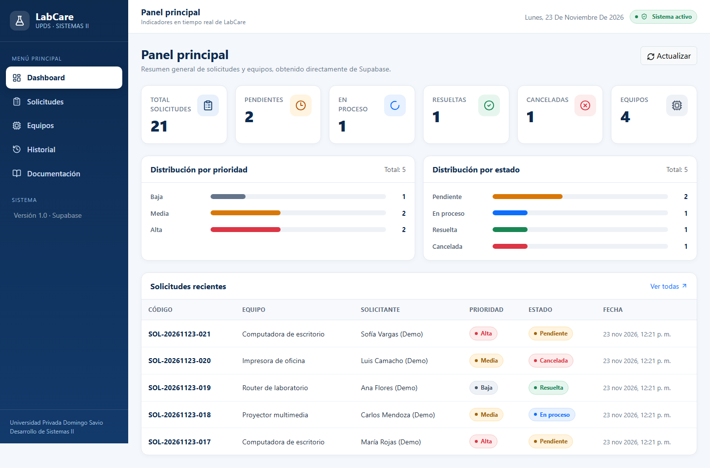

## 15.2 Listado de solicitudes activas

Tabla con código, equipo, solicitante, prioridad, estado, fecha y acciones.

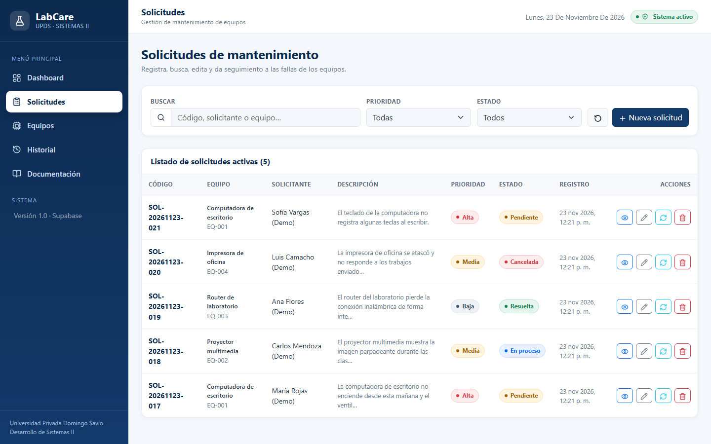

## 15.3 Búsqueda y filtros combinados

Búsqueda por solicitante junto con los filtros de prioridad y estado.

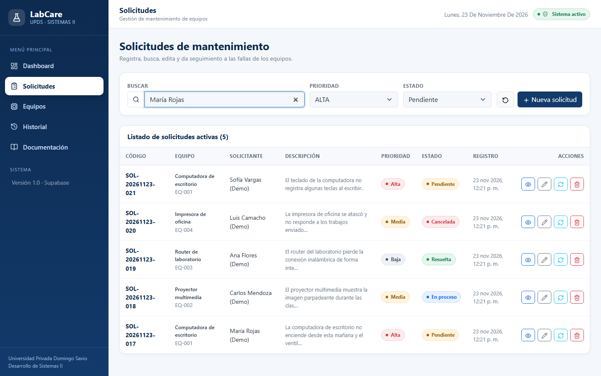

## 15.4 Registro de solicitud

Modal con el selector de equipos, solicitante, descripción y prioridad.

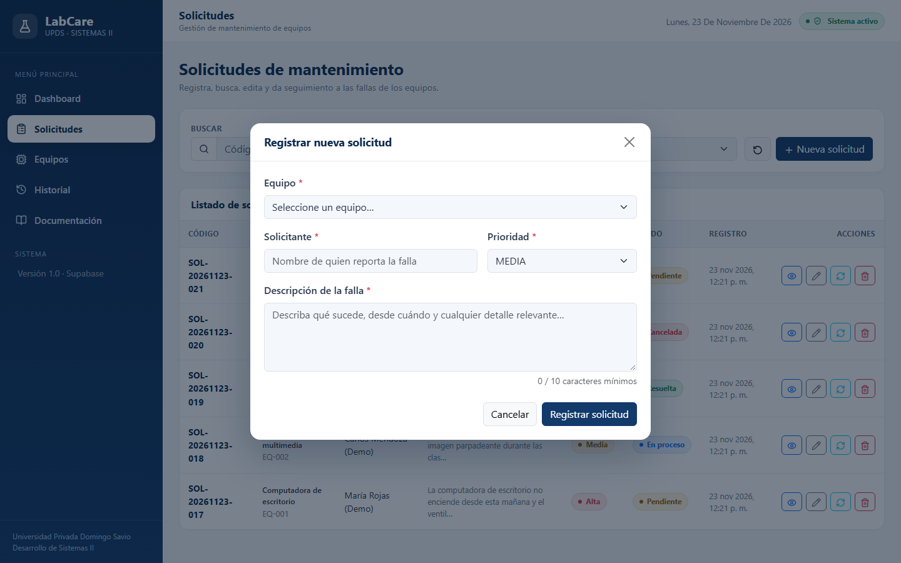

## 15.5 Detalle de solicitud

Información completa y línea de tiempo del historial de estados.

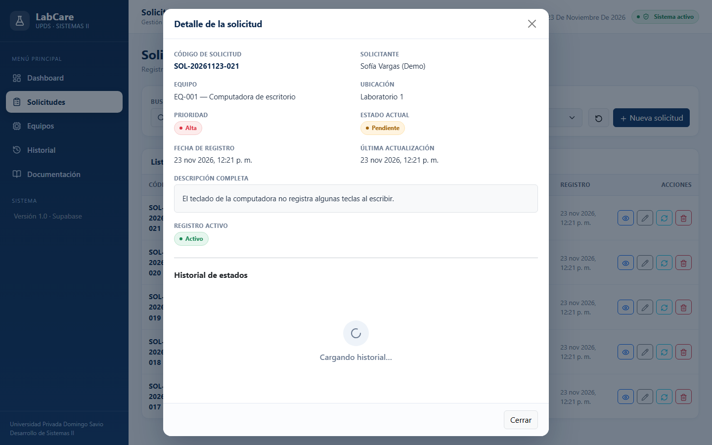

## 15.6 Cambio de estado

Solo se muestran las transiciones permitidas según el estado actual.

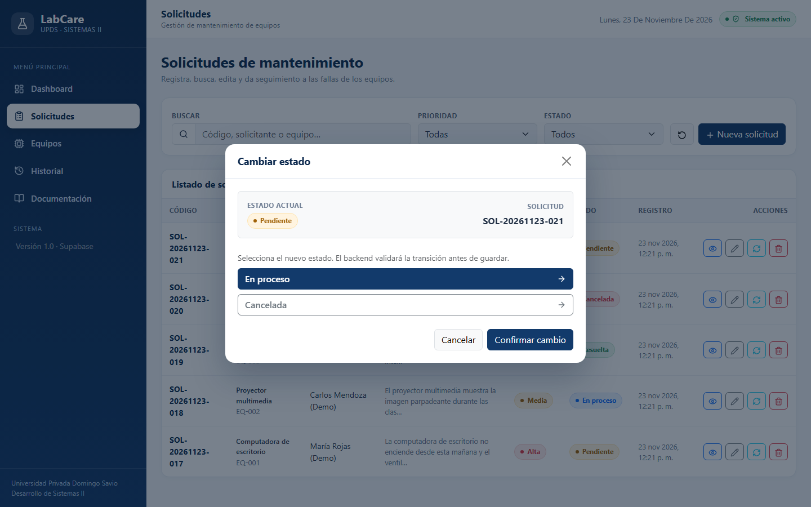

## 15.7 Confirmación de eliminación lógica

SweetAlert2 solicita confirmación antes de cambiar `activo` a FALSE.

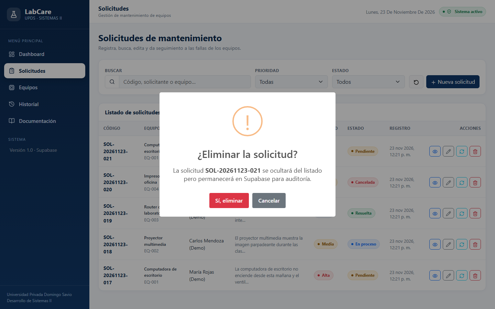

## 15.8 Catálogo de equipos

Los cuatro equipos iniciales leídos desde Supabase.

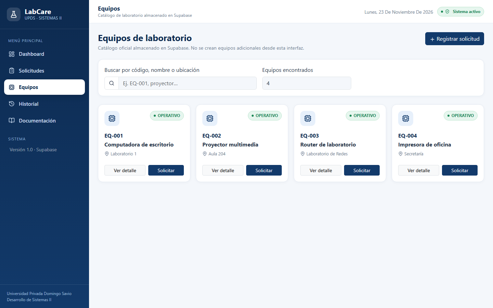

## 15.9 Historial y seguimiento

Todas las solicitudes, incluidas las eliminadas lógicamente.

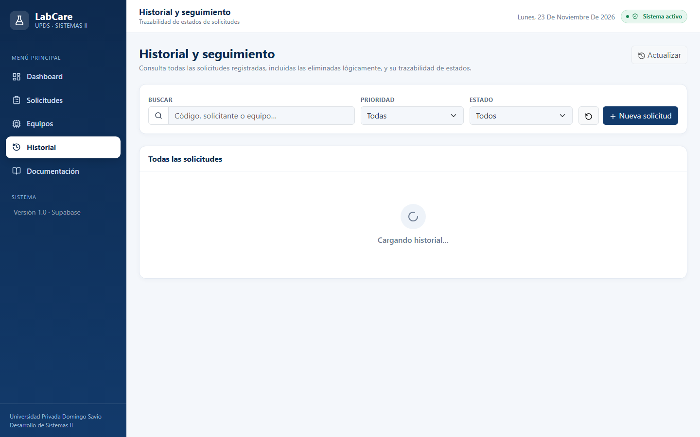

## 15.10 Vista móvil del dashboard

Distribución de tarjetas y gráficos en una pantalla de 390 px.

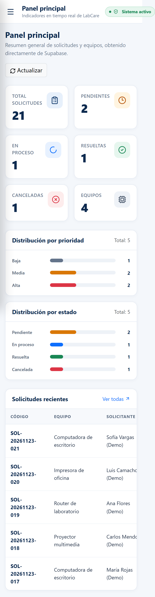

## 15.11 Navegación móvil

Sidebar desplegable desde la barra superior.

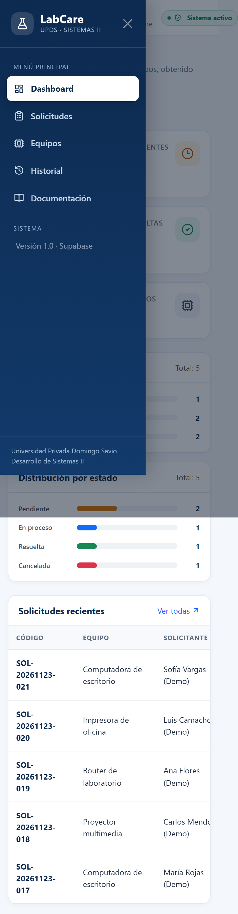

## 15.12 Solicitudes en móvil

Tabla adaptada con desplazamiento horizontal controlado.

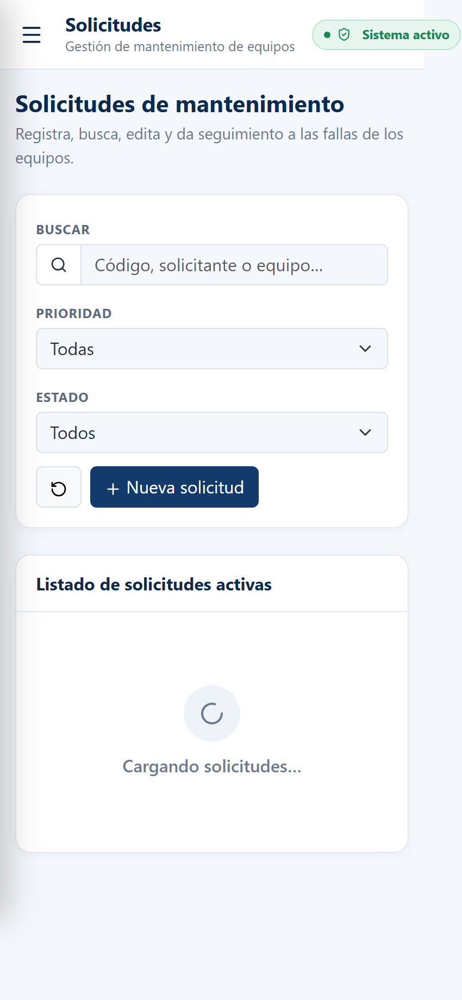

---

# EVALUACIÓN TEÓRICA

**1. Explique la responsabilidad de Modelo, Vista y Controlador dentro de MVC. Indique qué componente debería validar una regla de negocio y por qué.**

En el patrón MVC el **Modelo** representa los datos y las reglas que gobiernan su estado: en LabCare están en `backend/models/solicitud.model.js` (prioridades, estados y transiciones permitidas), en los repositorios que consultan Supabase y en los servicios que aplican las reglas de negocio. La **Vista** es la capa de presentación: los componentes y páginas de React que muestran el dashboard, las tablas, los modales y los formularios, sin conocer consultas SQL ni credenciales. El **Controlador** es el intermediario: recibe la petición HTTP, extrae y valida el formato de la entrada, delega la operación al servicio y devuelve una respuesta JSON con el código HTTP adecuado. La regla de negocio debe validarla el Modelo o, en esta arquitectura por capas, el **servicio del dominio**, porque es la única capa que debe ser independiente del protocolo HTTP y reutilizable desde cualquier cliente (navegador, Postman o cualquier script externo). Por ejemplo, `esTransicionPermitida()` define que `RESUELTA` es terminal y `solicitudesService.cambiarEstado()` la aplica antes de escribir en Supabase; si esa validación estuviera solo en el botón de React, cualquier petición directa podría saltársela.

**2. ¿Qué diferencia existe entre POST, PUT y PATCH? Mencione una operación de LabCare que corresponda a cada método.**

`POST` se usa para **crear** un recurso nuevo en una colección; no es idempotente, porque repetirlo genera otro registro. En LabCare corresponde a `POST /api/solicitudes`, que crea una solicitud con código `SOL-AAAAMMDD-XXX`, estado `PENDIENTE` y `activo = TRUE`, y responde 201. `PUT` se usa para **reemplazar** la representación completa de un recurso existente; es idempotente y en LabCare corresponde a `PUT /api/solicitudes/:id`, donde se envían juntos equipo, solicitante, descripción y prioridad, sin modificar ID, código, fecha de registro ni estado. `PATCH` aplica una **modificación parcial**; también es idempotente y en LabCare corresponde a `PATCH /api/solicitudes/:id/estado`, que cambia únicamente el campo `estado` después de verificar la transición. La distinción importa porque evita operaciones ambiguas: editar datos descriptivos y cambiar el estado son operaciones independientes con reglas distintas.

**3. ¿Qué es una prueba negativa? Escriba un caso de prueba negativo para el cambio de estado de una solicitud.**

Una prueba negativa verifica que el sistema **rechace correctamente** una entrada inválida, en lugar de comprobar solo el camino feliz; confirma que las validaciones, los códigos de error y los mensajes son coherentes y que no se produce una modificación indebida de datos. En LabCare, un caso negativo para el cambio de estado es: **DADO** una solicitud con estado `RESUELTA`, **CUANDO** se envía `PATCH /api/solicitudes/:id/estado` con `{"estado":"PENDIENTE"}`, **ENTONCES** la API responde HTTP 409 con `{"success":false,"error":"Transición de estado no permitida"}`, el registro permanece en `RESUELTA` en Supabase y no se inserta una nueva fila en `historial_estados`. Este caso se ejecutó como CP-08 dentro de `npm run verificar:api`. Otros ejemplos negativos ya ejecutados son el solicitante vacío (CP-02), la descripción corta (CP-03) y la prioridad `URGENTE` (CP-04), todos rechazados con 400.

**4. ¿Qué significa utilizar IA de forma responsable en desarrollo? Mencione una forma concreta de verificar una sugerencia generada por IA.**

Utilizar IA de forma responsable significa tratar sus respuestas como **propuestas que deben revisarse**, no como verdades automáticas: hay que contrastarlas con la documentación oficial, ejecutar el código generado, revisar los cambios línea por línea, comprobar que no filtre credenciales ni dependencias inseguras, y documentar cuándo se usó como apoyo sin atribuirle decisiones de diseño no validadas. En este proyecto, la IA sugirió usar únicamente `SUPABASE_SERVICE_ROLE_KEY` en el backend, pero al consultar la documentación actual de Supabase se comprobó que el panel ahora entrega `sb_secret_...` en `SUPABASE_SECRET_KEY`; la sugerencia se ajustó para aceptar ambos formatos. La verificación concreta fue ejecutar `GET /api/health` (que devolvió `"supabase":"conectado"`) y `npm run verificar:api` (17/17 comprobaciones correctas contra Supabase), además de confirmar con `npm audit --omit=dev` que no había vulnerabilidades y revisar que la clave secreta no apareciera en `frontend/.env` ni en el bundle compilado.

---

**Resultado de la verificación:** Supabase conectado, `npm test` 12/12, `npm run lint` sin errores, `npm run build` correcto, `npm run verificar:api` 17/17 y `npm audit --omit=dev` sin vulnerabilidades. Los detalles están en `docs/MATRIZ_PRUEBAS.md`.
