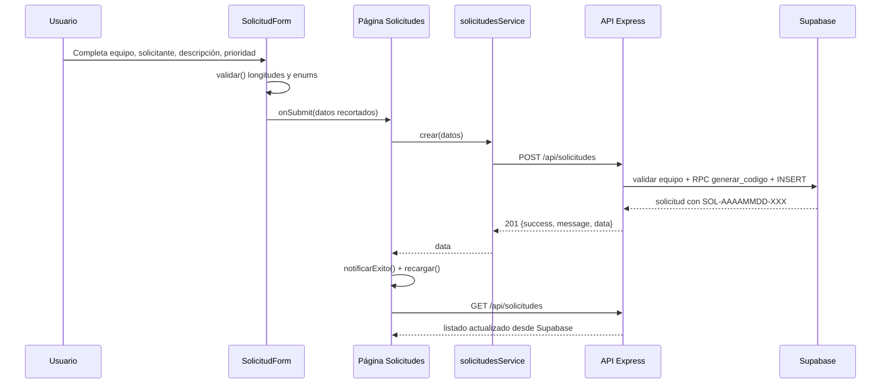

# Frontend de LabCare

Documentación técnica de la interfaz web de LabCare. Explica la estructura React, el flujo de datos hacia la API, las validaciones, los modales y los fragmentos de código más importantes. El código completo está en `frontend/src/`.

---

## 1. Responsabilidades

El frontend **no habla con Supabase**. Solo consume la API Express en `http://localhost:3000/api` mediante Axios. Toda regla de negocio importante (transiciones, códigos, eliminación lógica) se decide en el backend.

| Tecnología | Uso concreto |
|---|---|
| React 19 + Vite | Interfaz y compilación |
| React Router 7 | Navegación entre Dashboard, Solicitudes, Equipos, Historial y Documentación |
| Bootstrap 5 | Grid, tablas, botones, formularios y responsive |
| Axios | Cliente HTTP con interceptor de errores |
| SweetAlert2 | Toasts y confirmación de eliminación |
| Lucide React | Iconografía |
| Playwright | Generación de capturas (script de desarrollo) |

---

## 2. Estructura

```text
frontend/
├── index.html
├── vite.config.js
├── .env.example                 # VITE_API_URL (sin credenciales de Supabase)
├── scripts/
│   ├── capturas.js              # 12 capturas de interfaz
│   └── capturas-pruebas.js      # 5 capturas de evidencia de pruebas
└── src/
    ├── main.jsx                 # entrada React
    ├── App.jsx                  # BrowserRouter
    ├── routes/AppRoutes.jsx     # rutas protegidas por el layout
    ├── layouts/                 # MainLayout, Sidebar, Topbar
    ├── pages/                   # Dashboard, Solicitudes, Equipos, Historial…
    ├── components/              # Modales, formularios, badges, tablas…
    ├── hooks/                   # useAsync, useSolicitudes, useEquipos
    ├── services/                # api.js + servicios por entidad
    ├── utils/                   # formato y notificaciones
    └── styles/labcare.css       # estilos propios sobre Bootstrap
```

---

## 3. Entrada y enrutamiento

`frontend/src/main.jsx` monta la aplicación y carga Bootstrap, SweetAlert2 y los estilos propios:

```jsx
import 'bootstrap/dist/css/bootstrap.min.css';
import 'sweetalert2/dist/sweetalert2.min.css';
import './index.css';
import './styles/labcare.css';

createRoot(document.getElementById('root')).render(
  <React.StrictMode>
    <App />
  </React.StrictMode>,
);
```

`App.jsx` solo aporta el router:

```jsx
import { BrowserRouter } from 'react-router-dom';
import AppRoutes from './routes/AppRoutes.jsx';

export default function App() {
  return (
    <BrowserRouter>
      <AppRoutes />
    </BrowserRouter>
  );
}
```

Todas las páginas comparten `MainLayout`, que controla el menú lateral responsive:

```jsx
// frontend/src/routes/AppRoutes.jsx
<Routes>
  <Route element={<MainLayout />}>
    <Route index element={<Dashboard />} />
    <Route path="solicitudes" element={<Solicitudes />} />
    <Route path="equipos" element={<Equipos />} />
    <Route path="historial" element={<Historial />} />
    <Route path="documentacion" element={<Documentacion />} />
    <Route path="404" element={<NotFound />} />
    <Route path="*" element={<Navigate to="/404" replace />} />
  </Route>
</Routes>
```

```jsx
// frontend/src/layouts/MainLayout.jsx
<div className="app-shell">
  <Sidebar abierto={menuAbierto} onCerrar={() => setMenuAbierto(false)} />
  <div className="lab-main">
    <Topbar onAbrirMenu={() => setMenuAbierto(true)} />
    <main className="lab-content">
      <Outlet />
    </main>
  </div>
</div>
```

El menú se construye con `NavLink`, por lo que la ruta activa se resalta sola:

```jsx
// frontend/src/layouts/Sidebar.jsx
const ENLACES = [
  { to: '/', label: 'Dashboard', icon: LayoutDashboard, fin: true },
  { to: '/solicitudes', label: 'Solicitudes', icon: ClipboardList },
  { to: '/equipos', label: 'Equipos', icon: Cpu },
  { to: '/historial', label: 'Historial', icon: History },
  { to: '/documentacion', label: 'Documentación', icon: BookOpen },
];

<NavLink
  to={to}
  end={fin}
  className={({ isActive }) => `lab-nav-link ${isActive ? 'active' : ''}`}
  onClick={onCerrar}
>
  <Icon size={18} />
  <span>{label}</span>
</NavLink>
```

---

## 4. Capa HTTP: Axios

La URL base viene de una variable de entorno del frontend. No hay ni una sola clave de Supabase aquí:

```js
// frontend/src/services/api.js
import axios from 'axios';

const baseURL = import.meta.env.VITE_API_URL || 'http://localhost:3000/api';

const api = axios.create({
  baseURL,
  timeout: 15000,
  headers: { 'Content-Type': 'application/json' },
});

api.interceptors.response.use(
  (response) => response,
  (error) => {
    const data = error.response?.data;
    error.mensaje = data?.error || 'No se pudo conectar con el servidor LabCare';
    error.detalles = data?.details || null;
    return Promise.reject(error);
  },
);

export default api;
```

El interceptor unifica el manejo de errores: cualquier pantalla puede mostrar `error.mensaje` sin conocer la forma de la respuesta.

Servicio de solicitudes:

```js
// frontend/src/services/solicitudesService.js
const extraer = (respuesta) => respuesta.data.data;

const listar = async (filtros = {}) => {
  const params = {};
  if (filtros.q) params.q = filtros.q;
  if (filtros.prioridad) params.prioridad = filtros.prioridad;
  if (filtros.estado) params.estado = filtros.estado;
  if (filtros.incluirInactivas) params.incluirInactivas = 'true';
  const { data } = await api.get('/solicitudes', { params });
  return data.data;
};

const obtener = async (id) => extraer(await api.get(`/solicitudes/${id}`));
const crear = async (datos) => extraer(await api.post('/solicitudes', datos));
const actualizar = async (id, datos) =>
  extraer(await api.put(`/solicitudes/${id}`, datos));
const cambiarEstado = async (id, estado) =>
  extraer(await api.patch(`/solicitudes/${id}/estado`, { estado }));
const eliminar = async (id) => extraer(await api.delete(`/solicitudes/${id}`));
const historial = async (id) =>
  extraer(await api.get(`/solicitudes/${id}/historial`));
```

---

## 5. Estado asíncrono con `useAsync`

En lugar de repetir `loading/error/data` en cada página, se usa un hook propio:

```js
// frontend/src/hooks/useAsync.js
export function useAsync(loader, deps = []) {
  const [estado, setEstado] = useState({
    data: null,
    loading: true,
    error: null,
  });

  const recargar = useCallback(loader, deps);

  useEffect(() => {
    let activo = true;
    setEstado((actual) => ({ ...actual, loading: true, error: null }));

    recargar()
      .then((data) => {
        if (activo) setEstado({ data, loading: false, error: null });
        return data;
      })
      .catch((error) => {
        if (activo) setEstado({ data: null, loading: false, error });
        return null;
      });

    return () => {
      activo = false;
    };
  }, [recargar]);

  const reemplazarData = (data) =>
    setEstado((actual) => ({ ...actual, data }));

  return { ...estado, recargar, reemplazarData };
}
```

El flag `activo` evita actualizar el estado si el componente se desmontó durante una petición.

Los filtros se convierten en dependencias del hook:

```js
// frontend/src/hooks/useSolicitudes.js
export function useSolicitudes(filtros = {}) {
  const { q, prioridad, estado } = filtros;

  const cargar = useCallback(
    () => solicitudesService.listar({ q, prioridad, estado }),
    [q, prioridad, estado],
  );

  return useAsync(cargar, [cargar]);
}
```

---

## 6. Pantalla de Solicitudes

Es la pantalla central: lista, filtra, abre modales y ejecuta mutaciones. Después de cada cambio llama a `recargar()` para traer datos frescos de Supabase:

```jsx
// frontend/src/pages/Solicitudes.jsx
const {
  data: solicitudes,
  loading,
  error,
  recargar,
} = useSolicitudes(filtros);

const guardarFormulario = async (datos) => {
  setGuardando(true);
  try {
    if (modalForm === 'crear') {
      await solicitudesService.crear(datos);
      notificarExito('Solicitud registrada correctamente');
    } else {
      await solicitudesService.actualizar(seleccionada.id, datos);
      notificarExito('Solicitud actualizada correctamente');
    }
    setModalForm(null);
    await recargar();
  } catch (error) {
    mostrarError(error, 'No se pudo guardar');
  } finally {
    setGuardando(false);
  }
};
```

Detalle e historial:

```jsx
const verDetalle = async (solicitud) => {
  setSeleccionada(solicitud);
  setModalDetalle(true);
  setTransiciones([]);
  setCargandoHistorial(true);
  try {
    const resultado = await solicitudesService.historial(solicitud.id);
    setTransiciones(resultado.transiciones || []);
  } catch (error) {
    notificarError(mensajeError(error));
  } finally {
    setCargandoHistorial(false);
  }
};
```

Cambio de estado:

```jsx
const confirmarCambioEstado = async (estado) => {
  setGuardando(true);
  try {
    await solicitudesService.cambiarEstado(seleccionada.id, estado);
    notificarExito('Estado actualizado correctamente');
    setModalEstado(false);
    await recargar();
  } catch (error) {
    mostrarError(error, 'Transición rechazada');
  } finally {
    setGuardando(false);
  }
};
```

Eliminación con confirmación:

```jsx
const eliminar = async (solicitud) => {
  const resultado = await confirmarEliminacion(solicitud.codigo_solicitud);
  if (!resultado.isConfirmed) return;
  try {
    await solicitudesService.eliminar(solicitud.id);
    notificarExito('Solicitud eliminada lógicamente');
    await recargar();
  } catch (error) {
    mostrarError(error, 'No se pudo eliminar');
  }
};
```

La tabla usa clases de Bootstrap y badges propios:

```jsx
<div className="lab-table-wrap">
  <table className="lab-table align-middle">
    <thead>
      <tr>
        <th>Código</th>
        <th>Equipo</th>
        <th>Solicitante</th>
        <th>Descripción</th>
      </tr>
    </thead>
  </table>
</div>
```

---

## 7. Formulario y validaciones

El formulario valida en cliente para dar feedback inmediato, pero el backend vuelve a validar con Zod. Es una validación de experiencia, no la única:

```jsx
// frontend/src/components/SolicitudForm.jsx
const validar = () => {
  const nuevos = {};
  if (!formulario.equipo_id) nuevos.equipo_id = 'Seleccione un equipo';
  if (formulario.solicitante.trim().length < 3)
    nuevos.solicitante = 'Ingrese al menos 3 caracteres';
  if (formulario.descripcion.trim().length < 10)
    nuevos.descripcion = 'Describa la falla con al menos 10 caracteres';
  if (!PRIORIDADES.includes(formulario.prioridad))
    nuevos.prioridad = 'Prioridad inválida';
  setErrores(nuevos);
  return Object.keys(nuevos).length === 0;
};

const enviar = (evento) => {
  evento.preventDefault();
  if (!validar()) return;
  onSubmit({
    equipo_id: formulario.equipo_id,
    solicitante: formulario.solicitante.trim(),
    descripcion: formulario.descripcion.trim(),
    prioridad: formulario.prioridad,
  });
};
```

El selector de equipos se llena desde la API, no con un arreglo quemado:

```jsx
<select id="equipo_id" value={formulario.equipo_id} ...>
  <option value="">Seleccione un equipo…</option>
  {equipos.map((equipo) => (
    <option key={equipo.id} value={equipo.id}>
      {equipo.codigo} — {equipo.nombre} ({equipo.ubicacion})
    </option>
  ))}
</select>
```

---

## 8. Transiciones de estado en la interfaz

Las reglas se reflejan en `utils/format.js` para no ofrecer botones inválidos:

```js
// frontend/src/utils/format.js
export const TRANSICIONES = {
  PENDIENTE: ['EN_PROCESO', 'CANCELADA'],
  EN_PROCESO: ['RESUELTA', 'CANCELADA'],
  RESUELTA: [],
  CANCELADA: [],
};
```

El modal muestra solo las opciones permitidas y avisa cuando el estado es final:

```jsx
// frontend/src/components/CambioEstadoModal.jsx
const permitidos = TRANSICIONES[solicitud?.estado] || [];
const [nuevoEstado, setNuevoEstado] = useState(permitidos[0] || '');

{permitidos.length === 0 ? (
  <div className="alert alert-secondary ...">
    La solicitud está en un estado final. No se permiten nuevas transiciones.
  </div>
) : (
  permitidos.map((estado) => (
    <button key={estado} type="button" onClick={() => setNuevoEstado(estado)}>
      {ETIQUETAS_ESTADO[estado]}
      <ArrowRight size={16} />
    </button>
  ))
)}
```

Aun así, el texto del modal lo dice explícitamente: **«El backend validará la transición antes de guardar»**. La UI es una guía; la autoridad es el servicio Express.

---

## 9. Notificaciones con SweetAlert2

```js
// frontend/src/utils/notificaciones.js
const toast = Swal.mixin({
  toast: true,
  position: 'top-end',
  showConfirmButton: false,
  timer: 3200,
  timerProgressBar: true,
  customClass: { popup: 'lab-toast' },
});

export const notificarExito = (mensaje) =>
  toast.fire({ icon: 'success', title: mensaje });

export const confirmarEliminacion = (codigo) =>
  Swal.fire({
    title: '¿Eliminar la solicitud?',
    html: `La solicitud <strong>${codigo}</strong> se ocultará del listado pero permanecerá en Supabase para auditoría.`,
    icon: 'warning',
    showCancelButton: true,
    confirmButtonColor: '#dc3545',
    confirmButtonText: 'Sí, eliminar',
    cancelButtonText: 'Cancelar',
  });
```

---

## 10. Dashboard

El dashboard usa el mismo hook `useAsync` y tarjetas que reciben datos reales de `/api/dashboard/estadisticas`:

```jsx
// frontend/src/pages/Dashboard.jsx
const cargar = useCallback(() => obtenerEstadisticas(), []);
const { data: stats, loading, error, recargar } = useAsync(cargar, [cargar]);

<StatCard
  label="Total solicitudes"
  value={stats.totalSolicitudes}
  icon={ClipboardList}
  variante="primary"
/>
```

El botón «Actualizar» llama a `recargar()`, por lo que la vista nunca depende de un caché local ni de datos simulados.

---

## 11. Estilos y responsive

Bootstrap aporta el sistema de columnas; LabCare añade una capa de estilos propia:

```jsx
<div className="row g-3 mb-4">
  <div className="col-6 col-lg-4 col-xl-2">
    <StatCard ... />
  </div>
</div>
```

En móvil, `main.jsx` carga `labcare.css`, donde las clases `lab-sidebar`, `lab-sidebar__backdrop` e `is-open` controlan el menú deslizable. El botón de cierre usa `d-lg-none` de Bootstrap, por lo que solo aparece en pantallas pequeñas.

---

## 12. Variables de entorno y scripts

`frontend/.env.example`:

```env
VITE_API_URL=http://localhost:3000/api
```

Ese es el **único** dato sensible de configuración del frontend, y no es un secreto. Las claves de Supabase viven exclusivamente en `backend/.env`.

```bash
cd frontend
npm install
npm run dev               # servidor de desarrollo Vite
npm run build             # compilación de producción
npm run lint              # ESLint
npm run capturas          # 12 capturas de interfaz
npm run capturas:pruebas  # 5 capturas de evidencia de pruebas
```

Para regenerar imágenes, la API debe estar levantada (`npm start` desde la raíz).

---

## 13. Flujo completo: registrar una solicitud



---

## 14. Seguridad y decisiones

- No existe `@supabase/supabase-js` en `package.json` del frontend.
- No existe ninguna clave `sb_secret_...` ni `eyJ...` en `frontend/`.
- Las validaciones del cliente se duplican en el backend con Zod.
- Los errores se muestran con `error.mensaje`, que el interceptor toma del JSON de la API.
- La eliminación pide confirmación y explica que el registro permanecerá en Supabase.
- Los estados finales no ofrecen transiciones en la UI, aunque el backend sigue siendo la fuente de verdad.

Relacionado: [`BACKEND.md`](BACKEND.md), [`docs/INFORME_PRUEBAS.md`](docs/INFORME_PRUEBAS.md) y [`DESARROLLO_COMPLETO_LABCARE.md`](DESARROLLO_COMPLETO_LABCARE.md).
