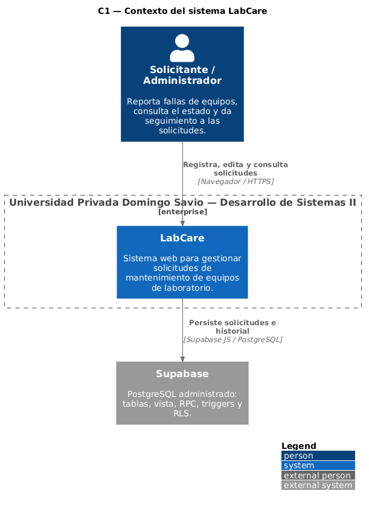
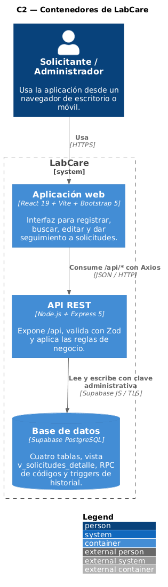
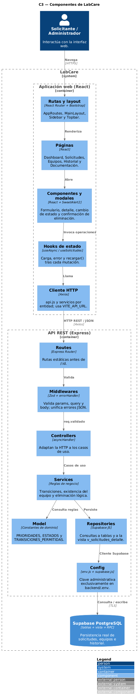
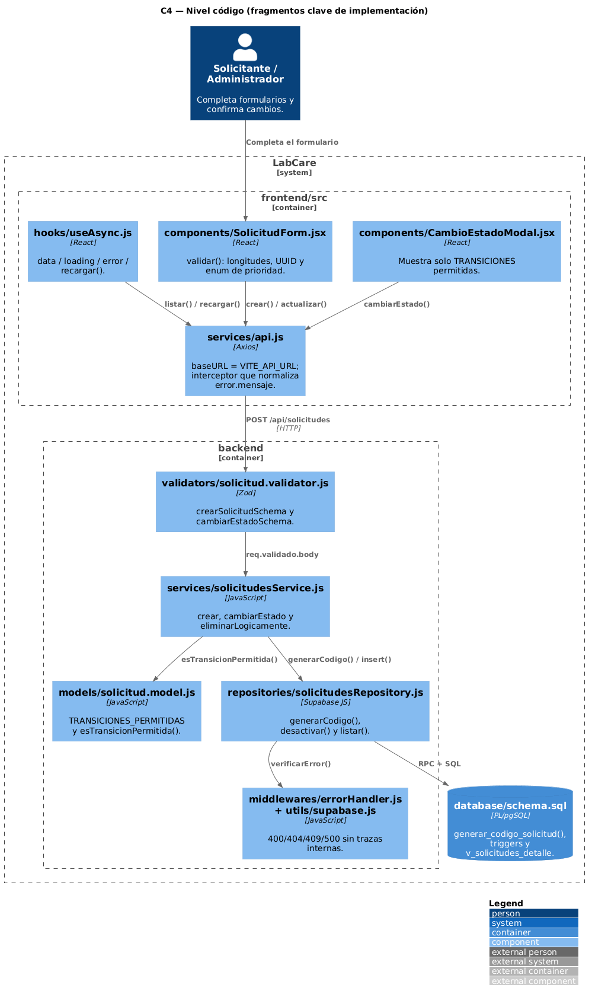
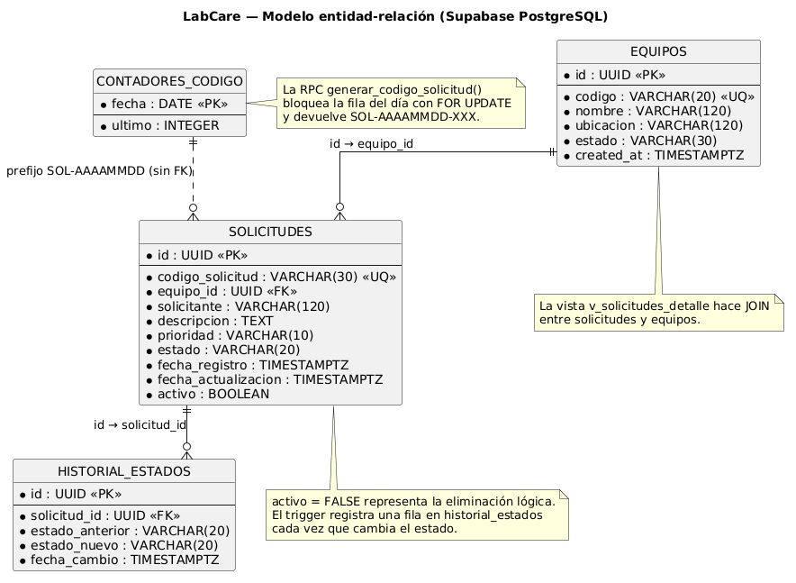

# Diagramas C4 y entidad-relación — LabCare

Esta carpeta contiene los cinco diagramas en formato **PlantUML**, listos para pegar en <https://www.plantuml.com/plantuml/>.

| Archivo | Nivel | Qué muestra |
|---|---|---|
| [`C1-contexto.puml`](C1-contexto.puml) | C1 — Contexto | Usuario, sistema LabCare y Supabase como sistema externo |
| [`C2-contenedores.puml`](C2-contenedores.puml) | C2 — Contenedores | Aplicación React, API Express y base de datos PostgreSQL |
| [`C3-componentes.puml`](C3-componentes.puml) | C3 — Componentes | Componentes internos del frontend y del backend |
| [`C4-codigo.puml`](C4-codigo.puml) | C4 — Código | Archivos y funciones clave: validadores, servicios, repositorios y RPC |
| [`ER-base-datos.puml`](ER-base-datos.puml) | Entidad-relación | Tablas, claves, FKs, contador de códigos y notas de negocio |

## Vistas previas

### C1 — Contexto

### C2 — Contenedores

### C3 — Componentes

### C4 — Código

### Entidad-relación

## Cómo visualizarlos en PlantUML Online

1. Abre <https://www.plantuml.com/plantuml/>.
2. Abre cualquiera de los archivos `.puml` con un editor de texto.
3. Copia **todo** el contenido y pégalo en el cuadro del sitio.
4. PlantUML renderizará el diagrama automáticamente. En la esquina superior derecha puedes descargarlo como PNG o SVG.

> Los diagramas C1 a C4 usan `!include` con la URL oficial de
> `C4-PlantUML`, tal como los ejemplos de la librería. Por eso necesitan
> conexión a Internet al renderizarlos online.

Los cinco archivos fueron validados contra el servidor público de PlantUML:
los cinco devolvieron HTTP 200 sin errores de sintaxis y las PNGs de esta
carpeta se generaron desde ese mismo render.

## Nota sobre el nivel C4

La librería oficial `C4-PlantUML` publica `C4_Context.puml`, `C4_Container.puml`
y `C4_Component.puml`, pero **no** publica un `C4_Code.puml` independiente. Para
representar el nivel 4 se usa `C4_Component.puml` con elementos que son archivos,
funciones y procedimientos reales del proyecto. El propio archivo lo indica en
un comentario.

## Relación con la documentación

- Código backend: [`BACKEND.md`](../../BACKEND.md)
- Código frontend: [`FRONTEND.md`](../../FRONTEND.md)
- Esquema SQL: [`database/schema.sql`](../../database/schema.sql)
- Memoria completa: [`DESARROLLO_COMPLETO_LABCARE.md`](../../DESARROLLO_COMPLETO_LABCARE.md)
- Resultados de pruebas: [`docs/INFORME_PRUEBAS.md`](../INFORME_PRUEBAS.md)
